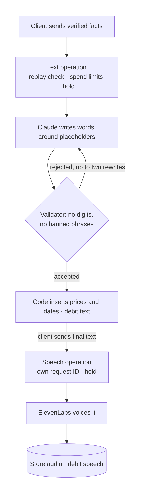

# Tellal: AI gateway for paid LLM and speech calls

**Claude (Anthropic) writes the words, code inserts every price and date, ElevenLabs speaks the result, and scoped keys, prepaid balances and spend limits guard every paid call. I designed, built and run it as sole engineer; [Kadans](https://github.com/berkaybakac/kadans-case-study), an in-store audio system for a 20+ branch grocery chain, is its first client.**

| | |
|---|---|
| **Role** | Designed, built, deployed and operate it end to end |
| **What it sells** | Prepaid text and speech character balances through scoped API keys |
| **Integrations** | Claude Messages API (copy), ElevenLabs (speech) |
| **Clients** | Kadans in production; per-project key scopes and profile allow-lists are built and tested with a second project |
| **Stack** | Python, FastAPI, SQLite (write-locked transactions), Jinja2, nginx, Let's Encrypt, Prometheus, Grafana, Playwright |

Source code is private. This page shows the real admin panel with test data and [a sample announcement](https://github.com/berkaybakac/kadans-case-study/blob/main/assets/announcement-sample.mp4).

## Architecture at a glance

| Part | Responsibility |
|---|---|
| `/v1` API (FastAPI) | Campaign-text and speech operations, keyed by client request ID; scoped keys per project |
| Operation store (SQLite) | Idempotency, balance holds and debits, spend limits, per-attempt cost attribution, audit |
| Provider adapters | Claude for copy, ElevenLabs for speech; configuration selects the adapter, versioned profiles the model or voice |
| Copy validator | Placeholder-only output, no digits in model words, banned phrases, length |
| Admin panel (server-rendered) | Balances, customers, limits, keys, usage and costs, fleet; same write path as the API |
| Release catalog and fleet view | Offers Kadans servers signed releases proven by the office install, and shows the Kadans fleet hub |
| Monitoring | Prometheus metrics, Grafana dashboards and alert rules for spend, balances and provider faults |

## How one announcement is made

<picture>
  <source media="(prefers-color-scheme: dark)" srcset="assets/summary-dark.png">
  
</picture>

*The owner-facing summary (test data): remaining characters per customer, this month's use and how long the balance lasts at the current pace, with a calm warning before one runs out.*

## LLM guardrails: prices and dates come from code

A wrong price read aloud in a store is unacceptable, so the model is never asked for one.

- **Placeholders only.** The model writes only the words around four placeholders. Code inserts product, prices and dates as spoken Turkish from exact decimals.
- **Mechanical validation.** A validator rejects any digit outside placeholders, missing or repeated placeholders, banned phrases and excess length. Rejected copy is never voiced.
- **Bounded rewrites.** A rejection, refusal or truncated answer gets up to two rewrites, each costed and preceded by a fresh spend check; the customer pays only for accepted copy.
- **Deterministic fallback.** After that, or when the copy budget is spent, the client sends its verified standard sentence to speech in the same voice.
- **Facts from the client.** Kadans sends only validated facts. Today-only, last-day and branch-exclusive openings are computed from ERP data, and restricted products are filtered out before any model call.
- **Voice changes follow.** When the voice or provider changes, Kadans re-renders live announcements within budget while the old audio keeps playing.

## Idempotency, spend limits and cost attribution

- **Idempotent requests.** A client request ID, checked against a stored payload hash, makes a replay return the stored result without a provider call, and a concurrent duplicate shares the call in flight, so the customer is never charged twice. Kadans derives request IDs from the exact input, so identical input from many branches is written and spoken once.
- **Prepaid ledger, settled per stage.** A hold is taken before any provider call and debited only when its result is stored; failures release it, and a late worker cannot reopen a settled failure. Copy and speech settle separately, so retrying failed audio never charges for the copy again.
- **Spend limits under one write lock.** A pause switch, global daily and monthly USD limits and each customer's monthly character allowance are checked in the claim's transaction, so parallel requests cannot race past them.
- **Cost attribution.** Each attempt records its model and cost; a provider refusal counts as zero, a paid, unusable reply at cost.

## Projects, scoped keys and versioned profiles

- **Projects and scoped keys.** Customers own revocable API keys, stored only as digests and scoped to text or speech, inside projects that list the profiles their keys may use. Out-of-scope calls are refused before any record, hold or provider call.
- **Versioned profiles.** Prompt, model and voice settings live in versioned profiles; every operation records the exact version and a fingerprint of its file, and a retry keeps the original version if the alias moves.
- **Copy model by evaluation.** On the same 20 sample campaigns, the chosen model passed the validator 20 of 20 with more natural Turkish at about $0.002 each; a cheaper one passed 19 at $0.0001.
- **One service, by decision.** Text and speech stay in one service; the recorded revisit condition is a speech queue that stays saturated or CPU that stays above 70%.

## Operations: admin panel, observability, deployment

- **Admin panel.** Server-rendered FastAPI and Jinja2 pages with one write path shared with the API, separate API and panel hosts, CSRF tokens, and confirmation modals that state the resulting balance before money moves. Several named admins sign in with mandatory TOTP, replay refusal and per-admin lockout; every login and ledger entry is audited.
- **Fleet view.** Every customer's servers, branches and players, faults first; a silent server shows red even if its last status said online, and the page says plainly when the hub cannot be reached.
- **Release catalog.** The office canary gets the newest signed release and other customers the one it installed successfully. Tellal never signs: releases are signed offline with Ed25519 and verified by each server.
- **Sealed relays.** Nightly backups and new-branch device bundles arrive sealed to the owner's key, so the relay cannot read them. Nightly support files are stored per customer for audited admin download.
- **Deployment and monitoring.** Deploys ship only committed code onto a shared VM, with per-host TLS, per-IP rate limits, configuration rollback and daily backups. Prometheus metrics, Grafana dashboards and repository-kept alert rules cover spend, balances and provider faults.

<picture>
  <source media="(prefers-color-scheme: dark)" srcset="assets/keys-dark.png">
  
</picture>

*Installation keys per customer and project, each scoped to speech, text or both (test data).*

<picture>
  <source media="(prefers-color-scheme: dark)" srcset="assets/tellal-fleet-dark.png">
  
</picture>

*The fleet view for Kadans customers: servers, branches and players, faults first (test data).*

## How I work

I own the architecture, every decision and every release. I write decisions down with their trade-offs, prove the money and price guarantees with tests, and verify on the running service. I use Claude Code and Codex daily as coding agents under my approval gates and test-enforced repository rules, and I own the correctness of every change.

Other production work: [Turnstile](https://github.com/berkaybakac/turnstile-case-study) · [all projects](https://github.com/berkaybakac)
