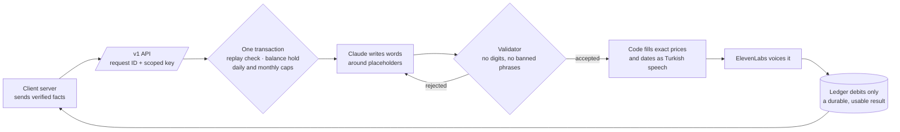
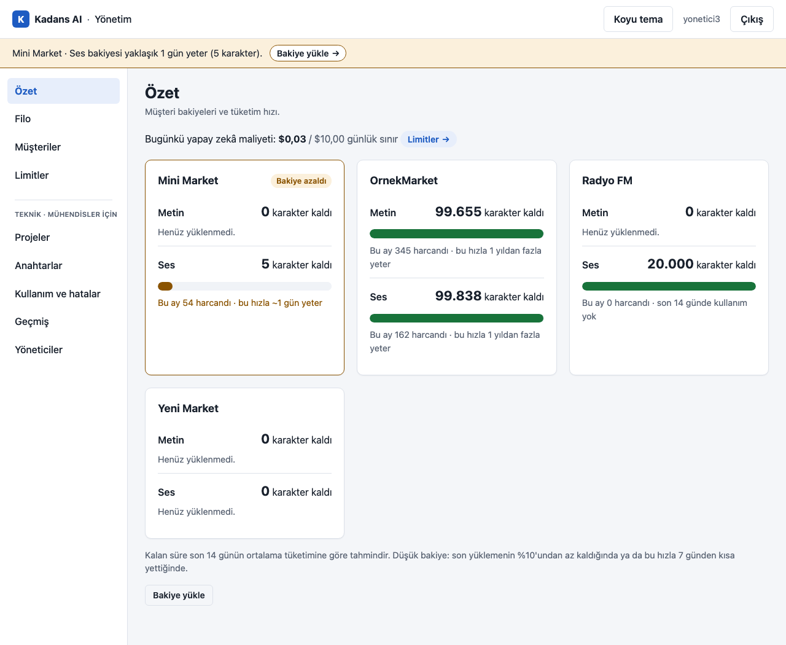
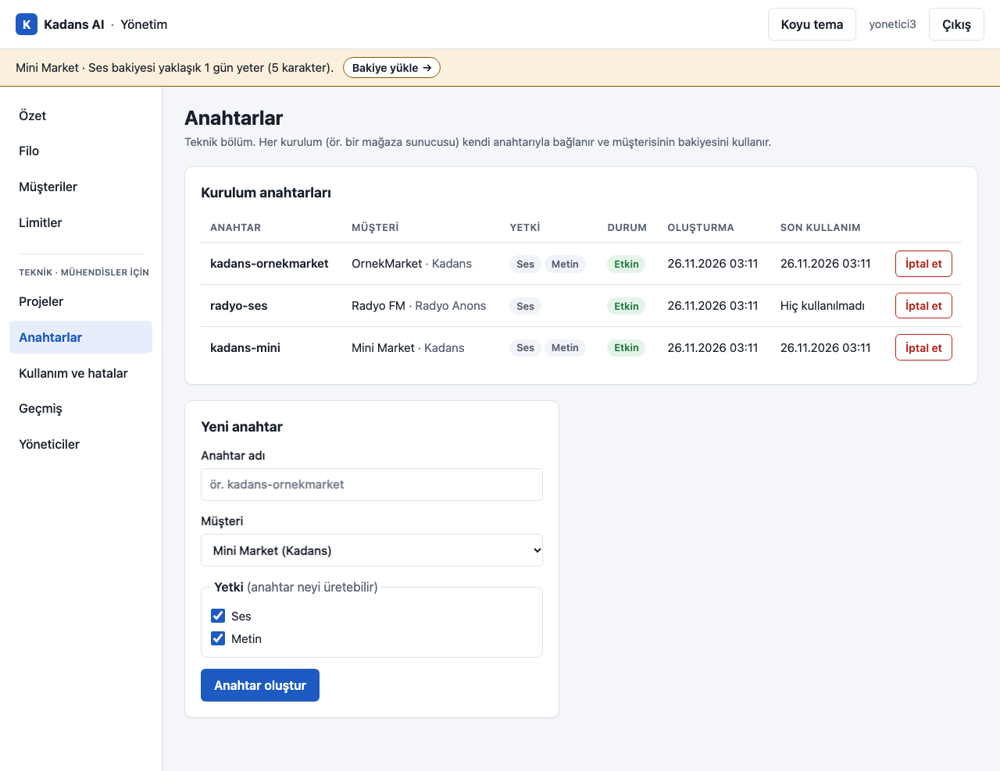
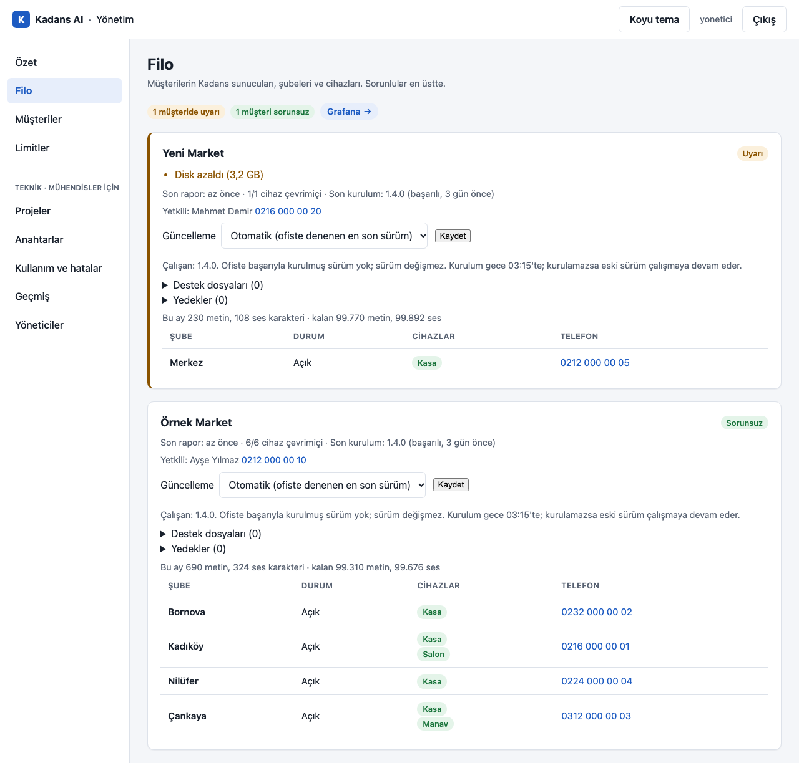

# Tellal: AI announcement platform

**A paid platform that turns verified facts into spoken retail announcements: Claude (Anthropic) writes the copy, ElevenLabs speaks it, and every call is guarded for accuracy and money. I designed, built and run it as sole engineer; [Kadans](https://github.com/berkaybakac/kadans-case-study), an in-store audio system for a 20+ branch grocery chain, is its first client.**

| | |
|---|---|
| **Role** | Designed, built, deployed and operate it end to end |
| **What it sells** | Prepaid text and speech character balances through scoped API keys |
| **Integrations** | Claude Messages API (copy), ElevenLabs (speech) |
| **Clients** | Built for several projects, each with its own keys and allowed profiles; Kadans is the first |
| **Stack** | Python, FastAPI, SQLite (write-locked transactions), Jinja2, nginx, Let's Encrypt, Prometheus, Grafana, Playwright |

Source code is private. This page describes the design and shows the real admin panel with test data.

## How one announcement is made

<picture>
  <source media="(prefers-color-scheme: dark)" srcset="assets/summary-dark.png">
  
</picture>

*The owner-facing summary (test data): remaining characters per customer, this month's use and how long the balance lasts at the current pace, with a calm warning before one runs out.*

## A model that cannot write a number

A wrong price read aloud in a store is unacceptable, so the model is never asked for one.

- **Placeholders only.** The model writes only the words around four placeholders. Code inserts product, prices and dates as spoken Turkish from exact decimals.
- **Mechanical validation.** A validator rejects any digit outside placeholders, missing or repeated placeholders, banned phrases and excess length. Rejected copy is never voiced.
- **Bounded rewrites.** A rejection, refusal or truncated answer gets up to two rewrites inside the same paid operation, each attempt costed and each preceded by a fresh spending check.
- **Deterministic fallback.** After that, or when the copy budget is spent, the client speaks its verified standard sentence in the same voice, so a store never goes silent because of the model.
- **Facts from the client.** Kadans sends only validated facts. Today-only, last-day and branch-exclusive openings are computed from ERP data, and restricted products are filtered out before any model call.
- **Voice changes follow.** When the voice or provider changes, Kadans re-renders live announcements within budget while the old audio keeps playing.

## Money safety for paid AI calls

- **Idempotent operations.** Every request carries a client request ID, checked against a stored payload hash. A replay returns the stored result without a provider call, and a concurrent duplicate shares the single call in flight. A timeout becomes "unknown", possibly billed, and allows only one more attempt.
- **Fact-derived request IDs.** Kadans derives UUIDv5 request IDs from tenant, exact facts and profile, so one discount across many branches is written and spoken once.
- **Prepaid ledger.** A hold is taken inside the claim transaction before any provider call and debited only on a durable, usable result; definite failures release it, and a settled failure can never be reopened by a late worker.
- **Caps inside the transaction.** A kill switch, a daily cap, monthly provider budgets and per-customer limits all run inside the same write-locked transaction as the claim, so parallel requests cannot overshoot. Each hit is logged with cap, limit and estimate.

## Built for more than one client

- **Projects and scoped keys.** Customers own revocable API keys, stored only as digests and scoped to text or speech, inside projects that list the profiles their keys may use. Out-of-scope calls are refused before any record, hold or provider call.
- **Versioned profiles.** Prompt, model and voice settings live in immutable, versioned profiles chosen per request; every output records the exact version and file hash, and a retry keeps the version chosen first.
- **Model and voice by evaluation.** The production model and voice were chosen with a scripted side-by-side run over 20 sample campaigns through the same validator, measuring acceptance and cost per campaign, plus listening. The chosen profile accepted 20 of 20.
- **One service, by decision.** Text and speech stay in one service; the recorded revisit condition is a speech queue that stays saturated or CPU that stays above 70%.

## Admin panel and operations

- **Admin panel.** Server-rendered FastAPI and Jinja2 pages with one write path shared with the API, separate API and panel hosts, CSRF tokens, and confirmation modals that state the resulting balance before money moves. Several named admins sign in with mandatory TOTP, replay refusal and per-admin lockout; every login and ledger entry is audited.
- **Fleet view.** Every customer's servers, branches and players, faults first; a silent server shows red even if its last status said online, and the page says plainly when the hub cannot be reached.
- **Release catalog.** Tellal answers each customer with the one release it should run and serves setup files by SHA-256 name. It never signs: releases are signed offline with Ed25519 and verified by each server.
- **Sealed relays.** Nightly backups and new-branch device bundles arrive sealed to the owner's key, so the relay cannot read them. Nightly support files are stored per customer for audited admin download.
- **Deployment and monitoring.** Deploys ship only committed code onto a shared VM, with per-host TLS, rate limits, configuration rollback and daily backups. Prometheus metrics, dashboards and Grafana alert rules for spend, balances and provider faults are provisioned from the repository.

<picture>
  <source media="(prefers-color-scheme: dark)" srcset="assets/keys-dark.png">
  
</picture>

*Installation keys per customer and project, each scoped to speech, text or both (test data).*

<picture>
  <source media="(prefers-color-scheme: dark)" srcset="assets/tellal-fleet-dark.png">
  
</picture>

*The fleet view for Kadans customers: servers, branches and players, faults first (test data).*

## How I work

I own the architecture, every decision and every release. I write decisions down with their trade-offs, prove each guarantee with a test that fails without it, and verify on the running system. I use Claude Code and Codex daily as coding agents under my approval gates and test-enforced repository rules, and I own the correctness of every change.
